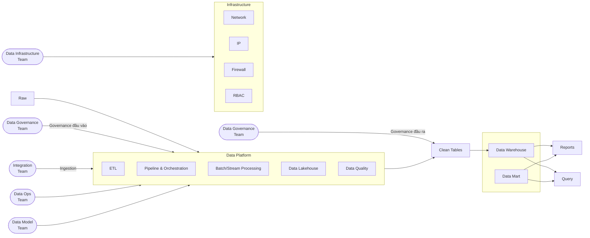

# VCB-role

# Phân chia trách nhiệm các nhóm dữ liệu

## 1. Data Infrastructure

- Cung cấp và vận hành nền tảng kỹ thuật phục vụ lưu trữ, xử lý
  và truy cập dữ liệu, bao gồm:
  - Storage và tài nguyên tính toán.
  - Network, IP, firewall và kết nối giữa các hệ thống.
  - Các môi trường và dịch vụ nền tảng cho pipeline, lakehouse, data warehouse và data mart.
- Thiết lập và vận hành các cơ chế kỹ thuật về xác thực, phân quyền.
- Theo dõi tính sẵn sàng, hiệu năng, khả năng mở rộng và chi phí của nền tảng.
- Phối hợp với các team để bảo đảm các luồng dữ liệu và người dùng được kết nối, truy cập đúng phạm vi cho phép.

## 2. Data Model

- Làm việc với bên liên quan để hiểu nhu cầu sử dụng dữ liệu và ý nghĩa nghiệp vụ của dữ liệu.
- Thiết kế cấu trúc dữ liệu phục vụ từng nhu cầu, bao gồm các bảng, trường dữ liệu, kiểu dữ liệu, khóa và mối quan hệ.
- Thiết kế mô hình cho các lớp dữ liệu như clean/curated tables, data warehouse và data mart.
- Xác định hoặc các quy tắc biến đổi và mapping từ dữ liệu nguồn sang dữ liệu có cấu trúc phù hợp với nhu cầu sử dụng của người dùng.
- Cung cấp đặc tả và phối hợp kiểm tra kết quả do Data Ops triển khai.

## 3. Data Ops

- Dựa trên mô hình, mapping và quy tắc đã thống nhất với Data Model
  để xây dựng và vận hành các pipeline biến đổi dữ liệu.
- Xây dựng hoặc sử dụng các công cụ và framework hỗ trợ:
  - ETL/ELT và các bước biến đổi dữ liệu.
  - Pipeline orchestration và lập lịch.
  - Xử lý batch hoặc streaming.
  - Kiểm tra chất lượng dữ liệu.
- Đưa dữ liệu từ vùng raw qua các lớp clean/curated và các cấu trúc để đưa vào Data Warehouse.
- Theo dõi pipeline, cảnh báo và xử lý lỗi; thực hiện chạy lại, khôi phục và kiểm soát độ trễ.
- Phối hợp với Integration khi lỗi xuất phát từ nguồn hoặc ingestion. Phối hợp với Data Model khi cần làm rõ quy tắc nghiệp vụ.

## 4. Integration

- Kết nối với các hệ thống nguồn và đưa dữ liệu vào nền tảng dữ liệu thông qua các cơ chế phù hợp như API, file, database, CDC hoặc stream.
- Thực hiện các bước chuyển đổi kỹ thuật cần thiết để dữ liệu có thể được tiếp nhận và xử lý tiếp, ví dụ: giải mã định dạng, tách trường hoặc chuyển sang dạng bảng.
- Bàn giao dữ liệu vào vùng raw cùng với thông tin cần thiết như cấu trúc, nguồn gốc, thời gian cập nhật và trạng thái tải dữ liệu.
- Kiểm tra các yêu cầu kỹ thuật tại bước tiếp nhận, chẳng hạn khả năng đọc dữ liệu, tính đầy đủ của lô tải và thay đổi cấu trúc nguồn.

## 5. Data Governance

- Xây dựng và duy trì các chính sách, tiêu chuẩn và quy trình quản trị dữ liệu phù hợp với yêu cầu kinh doanh, bảo mật và pháp luật.
- Phân loại dữ liệu và xác định:
  - Dữ liệu nào được phép thu thập và sử dụng, cho mục đích nào.
  - Đối tượng nào được phép truy cập và ở mức độ nào.
  - Trường hợp nào cần masking hoặc áp dụng biện pháp bảo vệ khác.
  - Trường hợp nào không được thu thập, chia sẻ hoặc sử dụng.
- Xác định hoặc điều phối việc thống nhất các tiêu chuẩn về chất lượng, metadata, định nghĩa dữ liệu, lineage và thời gian lưu giữ.
- Quy định rõ ai phê duyệt quyền truy cập và các ngoại lệ.
- Phối hợp với Data Infrastructure và Data Ops để triển khai các chính sách thành kiểm soát kỹ thuật trên nền tảng và pipeline.

## Điểm bàn giao giữa các nhóm

- Integration bàn giao dữ liệu đã được tiếp nhận vào vùng raw, cùng thông tin về nguồn và cấu trúc, cho Data Ops.
- Data Model bàn giao mô hình, mapping và quy tắc biến đổi cho Data Ops, các quy tắc nghiệp vụ cần được xác nhận với bên sở hữu dữ liệu.
- Data Ops triển khai và vận hành pipeline theo các đặc tả đã thống nhất.
- Data Infrastructure cung cấp và vận hành nền tảng cho toàn bộ luồng.
- Data Governance đặt ra hoặc điều phối các chính sách áp dụng xuyên suốt vòng đời dữ liệu. Các team liên quan chịu trách nhiệm thực hiện những kiểm soát thuộc phạm vi của mình.
